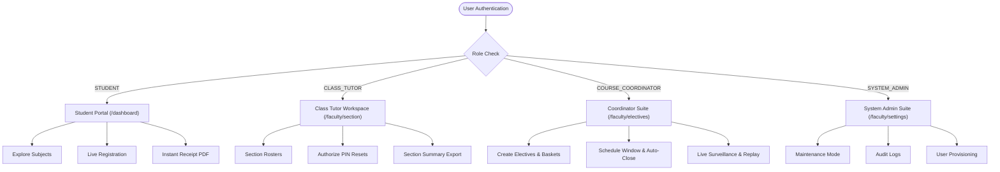

# Electify — Comprehensive User Manual
### Smart University Elective Registration & Academic Cohort Management System
**SRM Institute of Science and Technology**

---

## 📖 Table of Contents
1. [Executive Summary & Quick Reference](#1-executive-summary--quick-reference)
2. [Role & Permission Matrix](#2-role--permission-matrix)
3. [Student Guide](#3-student-guide)
   - [3.1 First-Time Sign-Up & Joining Your Class Section](#31-first-time-sign-up--joining-your-class-section)
   - [3.2 Returning Student Sign-In](#32-returning-student-sign-in)
   - [3.3 Student Dashboard Overview](#33-student-dashboard-overview)
   - [3.4 Subject Explorer & Syllabus Preview](#34-subject-explorer--syllabus-preview)
   - [3.5 Registration Countdown & Live Window](#35-registration-countdown--live-window)
   - [3.6 Selecting & Locking Elective Choices](#36-selecting--locking-elective-choices)
   - [3.7 Instant Receipt & Official PDF Download](#37-instant-receipt--official-pdf-download)
   - [3.8 Password Recovery & Help](#38-password-recovery--help)
4. [Class Tutor Guide](#4-class-tutor-guide)
   - [4.1 Staff Login & Academic Session Selection](#41-staff-login--academic-session-selection)
   - [4.2 Generating Class Signup Codes for Students](#42-generating-class-signup-codes-for-students)
   - [4.3 Section Switcher & Claiming Multi-Sections](#43-section-switcher--claiming-multi-sections)
   - [4.4 Class Roster & Student Live Tracking](#44-class-roster--student-live-tracking)
   - [4.5 Authorizing Student Password / PIN Resets](#45-authorizing-student-password--pin-resets)
   - [4.6 Section Registration Reports & PDF Export](#46-section-registration-reports--pdf-export)
5. [Course Coordinator Guide](#5-course-coordinator-guide)
   - [5.1 Staff Onboarding & Generating Invite Codes](#51-staff-onboarding--generating-invite-codes)
   - [5.2 Academic Session & Year Server Workflow](#52-academic-session--year-server-workflow)
   - [5.3 Elective Catalogue & Seat Allocation](#53-elective-catalogue--seat-allocation)
   - [5.4 Registration Window Scheduling & Auto-Close](#54-registration-window-scheduling--auto-close)
   - [5.5 Live Surveillance & Seat Meter Monitor](#55-live-surveillance--seat-meter-monitor)
   - [5.6 Audit Trail, Registration Replay & Master Reports](#56-audit-trail-registration-replay--master-reports)
6. [System Administrator Guide](#6-system-administrator-guide)
   - [6.1 Root Security & Single-Session Sentinel](#61-root-security--single-session-sentinel)
   - [6.2 Global System Settings & Maintenance Mode](#62-global-system-settings--maintenance-mode)
   - [6.3 Audit Logging & Database Health](#63-audit-logging--database-health)
7. [Technical Architecture & Safeguards](#7-technical-architecture--safeguards)
8. [Frequently Asked Questions & Troubleshooting](#8-frequently-asked-questions--troubleshooting)

---

## 1. Executive Summary & Quick Reference

Electify is a high-performance, atomic full-stack university elective registration platform designed to eliminate overbooking, waitlists, and manual spreadsheet administration. 

### Key Access Portals

| Portal | URL | Primary Users |
| :--- | :--- | :--- |
| **Official Web Application Portal** | [https://electifysrm.vercel.app/login](https://electifysrm.vercel.app/login) | All Students, Tutors, Coordinators, Admins |
| **Backend REST API** | [https://electifysrm.vercel.app/api](https://electifysrm.vercel.app/api) | Developers, External Integrations |
| **Swagger Interactive Docs** | [https://electifysrm.vercel.app/api/docs](https://electifysrm.vercel.app/api/docs) | API Reference & SQA Testing |
| **Live Database Health** | [https://electifysrm.vercel.app/api/health/db](https://electifysrm.vercel.app/api/health/db) | Health Monitoring & System Check |
| **Local Development Web Portal** | `http://localhost:3000/login` | Local Offline Development & Testing |
| **Local Backend REST API** | `http://localhost:4000/api` | Local API Development |

### Default Credentials for Testing / Demonstration

| Role | Username / Identifier | Password | Access Level |
| :--- | :--- | :--- | :--- |
| **System Admin** | `srmelectify@gmail.com` | `Electify@2026` | Full University Control & Audit Logs |
| **Course Coordinator** | `sabenabanu@srmist.edu.in` | `Electify@2026` | Electives, Windows, Live Monitor, Reports |
| **Class Tutor** | `angelb1@srmist.edu.in` | `Electify@2026` | Class Rosters, PIN Resets, Section Reports |
| **Student** | SRM Register Number (e.g. `RA2411003010001`) | Set by Student | Subject Explorer, Seat Claim, Receipt PDF |

---

## 2. Role & Permission Matrix



| Feature / Capability | Student | Class Tutor | Course Coordinator | System Admin |
| :--- | :---: | :---: | :---: | :---: |
| Browse Subject Descriptions & Syllabi | ✅ | ✅ | ✅ | ✅ |
| Register for Electives & Claim Seats | ✅ | ❌ | ❌ | ❌ |
| Download Registration Receipt PDF | ✅ | ❌ | ❌ | ❌ |
| View Class Roster & Submission Status | ❌ | ✅ | ✅ | ✅ |
| Authorize Student Password / PIN Reset | ❌ | ✅ | ❌ | ✅ |
| Switch Between Assigned Sections | ❌ | ✅ | ✅ | ✅ |
| Create / Edit Elective Offerings & Capacities | ❌ | ❌ | ✅ | ✅ |
| Schedule Registration Windows (Start / End) | ❌ | ❌ | ✅ | ✅ |
| Real-time Live Event Surveillance Monitor | ❌ | ✅ (View) | ✅ (Full) | ✅ (Full) |
| Registration Replay & Department Audit | ❌ | ❌ | ✅ | ✅ |
| Toggle Maintenance Mode & Global Policies | ❌ | ❌ | ❌ | ✅ |

---

## 3. Student Guide

### 3.1 First-Time Sign-Up & Joining Your Class Section
If you do not have an Electify student account yet, you must complete the one-time **Join Class** onboarding process:
1. Obtain the official **Class Signup Code** (format: `EFCL-XXXX`) from your Class Tutor.
2. Open your web browser and navigate to: **[https://electifysrm.vercel.app/join](https://electifysrm.vercel.app/join)** (or click **"Join with Class Code"** on the login page).
3. Type or paste your Class Signup Code.
4. The system validates the code in real time and displays your verified class details:
   - Programme (e.g. *B.Tech Computer Science & Engineering*)
   - Department, Section (e.g. *Section A*), and Batch Year
   - Class Tutor's Name and available enrollment spots
5. Complete your student profile:
   - **Full Name**: Enter your official name as registered with SRMIST.
   - **Official SRM Email**: Must be an `@srmist.edu.in` address (e.g. `rs1234@srmist.edu.in`).
   - **SRM Register Number**: Enter your official roll number (e.g. `RA2411003010001`).
   - **Password**: Choose a secure password (minimum 8 characters, letters & numbers). Confirm password by re-typing it.
6. Click **Create Student Account & Join Class**.
7. Your account is created instantly and mapped to your exact class roster, redirecting you directly to the Student Dashboard!

### 3.2 Returning Student Sign-In
Once you have created your account:
1. Navigate to: **[https://electifysrm.vercel.app/login](https://electifysrm.vercel.app/login)**.
2. Enter your **SRM Register Number** (e.g. `RA2411003010001`) or official SRM email.
3. Enter your password and click **Sign in to Electify**.

> [!IMPORTANT]
> **Strict Single-Device Policy (Laptop OR Phone Only)**:
> Students are strictly restricted to **one active device at a time**. You can sign in using either your laptop OR your mobile phone, but **never both simultaneously**. Signing in on a second device or new tab immediately invalidates and disconnects the previous device with zero latency, preventing seat-sniping and unauthorized proxy logins. (Faculty and Administrators are permitted up to 3 active devices simultaneously).

### 3.3 Student Dashboard Overview
Upon logging in, your personalized dashboard displays:
- **Student Profile**: Name, Register Number, Department, Batch, and Section.
- **Event Status Banner**: Indicates whether the registration window is **Upcoming**, **Live**, or **Closed**.
- **Quick Links**: Direct buttons to the **Subject Explorer**, **Live Registration**, or **My Registration**.

### 3.3 Subject Explorer & Syllabus Preview
Before the registration window opens, you can thoroughly review all offered electives:
1. Navigate to **Subjects** (`/dashboard/subjects`) from the sidebar navigation.
2. Filter courses by Department, Category (Professional Elective, Open Elective), or keyword search.
3. Click on any subject card to inspect:
   - Course Code and Full Title (e.g. `21CSE301T — Cloud Computing Architecture`)
   - Credit value (e.g. `3 Credits`)
   - Detailed course syllabus, objectives, and prerequisites
   - Maximum seating capacity

> [!TIP]
> The Subject Explorer is read-only and does not lock seats. Use this preview mode to plan your preferred choices before the registration countdown reaches zero.

### 3.4 Registration Countdown & Live Window
- When an elective event is scheduled, a live synchronized countdown clock ticks down on `/countdown`.
- The countdown uses **Server-Synchronized Time (NTP drift corrected)**, ensuring every student enters the selection screen at the exact same millisecond regardless of device clock discrepancies.
- Once the clock reaches zero, the button switches to **Enter Registration**.

### 3.5 Selecting & Locking Elective Choices
1. On `/dashboard/electives`, you will see the active Elective Baskets/Groups.
2. For each basket, available subjects show live real-time seat counters:
   - Green badge: Seats available (e.g., `42 / 60 remaining`)
   - Amber badge: Filling fast (less than 10% remaining)
   - Red badge: Course filled (0 seats available)
3. Select your desired course for each required group.
4. Click **Submit Registration**.
5. The system performs an **atomic row-locking PostgreSQL transaction**:
   - Confirms seat availability in milliseconds.
   - Safely decrements the seat count.
   - Records your timestamped enrollment.

> [!IMPORTANT]
> If a course fills up while you are choosing, the system will prevent overbooking and prompt you to choose an alternative available subject immediately with zero waitlist confusion.

### 3.6 Instant Receipt & Official PDF Download
- After successful submission, you are routed to `/dashboard/success`.
- A permanent **Official Receipt ID** is generated, formatted as:
  `ELC-<YEAR>-<ODD|EVEN>-<SEQUENCE_NUMBER>` (e.g., `ELC-2026-EVEN-00421`).
- Click **Download PDF Receipt** to save an encrypted, printable verification document containing:
  * University header & timestamp
  * Student identification details
  * Enrolled course code, course title, and department
  * Verification QR checksum

### 3.7 Password Recovery & Help
- If you forget your password, you cannot unilaterally reset it. This prevents account takeover attacks during competitive registration windows.
- Contact your **Class Tutor**. Your tutor will verify your identity in class and issue an authorized one-time reset authorization.

---

## 4. Class Tutor Guide

### 4.1 Staff Login & Academic Session Selection
1. Navigate to: **[https://electifysrm.vercel.app/login](https://electifysrm.vercel.app/login)**.
2. Sign in with your faculty email (e.g., `angelb1@srmist.edu.in`) and password: `Electify@2026`.
3. Upon first sign-in, the **Academic Session Selector** (`/faculty/session-select`) appears.
4. Select the current working academic year (e.g., `2025–2026 Even Semester`).
5. Click **Enter Workspace**.

> [!TIP]
> **Multi-Device Support for Faculty & Staff**: Class Tutors, Course Coordinators, and System Administrators are permitted up to **3 simultaneous active devices** (e.g. office workstation, mobile phone, and classroom podium/laptop). If a 4th device logs in, only the oldest device session is automatically retired, leaving your newer sessions active without interruption.

### 4.2 Generating Class Signup Codes for Students
As a Class Tutor, you onboard your students by generating an official Class Signup Code:
1. Make sure your active class is selected in the top-bar section switcher (e.g. `CSE-AIML Section A`).
2. Navigate to **Section Roster** (`/faculty/section`) or **Students** (`/faculty/students`).
3. Click **Generate Class Signup Code**.
4. Set the maximum number of students (e.g. 60) and expiration date.
5. Click **Generate Code**. The system produces an official enrollment code (e.g. `EFCL-8921`).
6. Share this code with your class section along with the onboarding link: **[https://electifysrm.vercel.app/join](https://electifysrm.vercel.app/join)**.

### 4.3 Section Switcher & Claiming Multi-Sections
- Electify allows tutors to manage multiple sections across batches.
- In the top navigation bar, locate the **Active Section Switcher** pill:
  * Click the dropdown to switch your active view between assigned sections (e.g. `CSE-AIML Section A` ↔ `CSE-AIML Section B`).
  * If you need to manage a new section, go to **Assign Sections** (`/faculty/assign-sections`), select your newly assigned section from the catalog, and click **Claim Section**.

### 4.4 Class Roster & Student Live Tracking
1. Open **Section Roster** (`/faculty/section`).
2. The roster displays every enrolled student in your selected class:
   - Register Number, Student Full Name, and SRM Email
   - Registration Status: **Confirmed** (Green), **In Progress** (Amber), or **Unregistered** (Red)
   - Chosen Elective Subject & Timestamp of submission
3. Filter by "Unregistered Only" to quickly identify students who have not yet selected their electives before the window deadline.

### 4.5 Authorizing Student Password / PIN Resets
If a student in your class loses access to their account:
1. In the sidebar, navigate to **Students** (`/faculty/students`).
2. Search for the student by Register Number or Name.
3. Verify the student's physical identity in your department.
4. Click **Authorize PIN Reset**.
5. The system issues a 15-minute temporary reset link or updates their initial PIN, allowing the student to sign in and choose a new password.

### 4.6 Section Registration Reports & PDF Export
1. Navigate to **Tutor Reports** (`/faculty/tutor-reports`).
2. Review aggregated metrics:
   - Total students in section
   - Total completed registrations (% turnout)
   - Distribution of students across elective courses
3. Click **Export Class List (PDF)** to download an official attendance roster for the Head of Department.
3. Click **Export Class List (PDF)** to download an official attendance roster for the Head of Department.

---

## 5. Course Coordinator Guide

### 5.1 Staff Onboarding & Generating Invite Codes
Course Coordinators can provision new Class Tutor accounts securely:
1. Sign in at: **[https://electifysrm.vercel.app/login](https://electifysrm.vercel.app/login)** with coordinator credentials (e.g., `sabenabanu@srmist.edu.in` / `Electify@2026`).
2. Navigate to **Invite Codes** (`/faculty/invites`).
3. Click **Generate Staff Invite**:
   - Role: **Class Tutor** (Prefix: `EFCT-`)
   - Department: Assign offering department
   - Max Uses & Expiry Date
4. Deliver the code to appointed faculty members to allow them to create their official staff credentials.

### 5.2 Academic Session & Year Server Workflow
Course Coordinators operate at the departmental and academic calendar level:
- Navigate to **Academic Sessions** (`/faculty/academic-sessions`).
- Create or configure academic terms (e.g. `2026 Even Semester`, `2027 Odd Semester`).
- The system guarantees complete **Year Server Data Isolation**: course registrations in 2026 are isolated from historical 2025 databases.

### 5.2 Elective Catalogue & Seat Allocation
1. Navigate to **Electives Management** (`/faculty/electives`).
2. Click **Create New Elective**:
   - Enter Subject Code (e.g. `21CSE302T`)
   - Subject Title (e.g. `Distributed Systems & Microservices`)
   - Offering Department
   - Credits and Syllabus outline
3. Configure **Seat Capacity**:
   - Set maximum capacity (e.g. `60 seats`).
   - Group subjects into **Elective Baskets** (e.g., `Professional Elective III — Basket A`).
   - Students will be required to pick exactly one subject per basket.

### 5.3 Registration Window Scheduling & Auto-Close
1. Navigate to **Window Control** (`/faculty/window`).
2. Set the event scheduling parameters:
   - **Opening Date & Time**: Exact second the registration unlocks for students.
   - **Closing Date & Time**: Deadline for submissions.
3. Configure Automation Safeguards:
   - **Auto-Close**: When enabled, the registration window closes automatically at the designated deadline without manual intervention.
   - **Allow Modifications**: Toggle whether students can change their chosen elective prior to the deadline.
4. Click **Publish & Schedule**.

### 5.4 Live Surveillance & Seat Meter Monitor
During a live registration event:
1. Navigate to **Live Monitor** (`/faculty/monitor`).
2. Watch real-time metrics updated via WebSocket / polling:
   - **Active Concurrent Students**: Real-time heartbeat of students currently in the portal.
   - **Seat Velocity**: Submissions per second.
   - **Real-Time Seat Meters**: Visual gauge bars showing capacity utilization per course.
3. **Emergency Controls**:
   - If server maintenance is required, click **Pause Registration Window** to freeze all submissions safely without dropping existing allocations.

### 5.5 Audit Trail, Registration Replay & Master Reports
1. **Registration Replay** (`/faculty/replay`):
   - Scrub through a timeline slider to replay the entire registration sequence from minute 0 to window close.
   - Inspect race conditions and verify that seats were awarded strictly on a first-come, first-served basis.
2. **Master Reports** (`/faculty/reports`):
   - Generate full Departmental Elective Allocation sheets.
   - Export master Excel and PDF documents for university exam cell records.

---

## 6. System Administrator Guide

### 6.1 Root Security & Role-Based Session Sentinel
- The primary root admin account `srmelectify@gmail.com` possesses immutable superuser privileges.
- Root accounts cannot be demoted, deactivated, or deleted by any API route or interface.
- All sessions are cryptographically signed with HS256 JWT tokens using `process.env.JWT_SECRET`.
- **Role-Based Session Sentinel Architecture**:
  * **Students**: Strictly enforced to **1 single active session**. Any attempt to open a secondary tab or second device immediately revokes earlier sessions to eradicate bot-driven sniping and credential sharing.
  * **Staff & Administrators (Class Tutor, Course Coordinator, System Admin)**: Permitted up to **3 simultaneous active devices**. Faculty can comfortably monitor registrations from a laptop, smartphone, and classroom smartboard concurrently. Logging in on a 4th device only rotates out the oldest device. Logging out on one device only signs out that specific device.

### 6.2 Global System Settings & Maintenance Mode
1. Navigate to **System Settings** (`/faculty/settings`).
2. **Maintenance Mode**:
   - When toggled ON, students and faculty are greeted by a friendly maintenance screen (`/maintenance`).
   - Administrators remain logged in to perform schema upgrades, seed data, or resolve database issues.
3. **Max Tutor Sections**:
   - Define the maximum number of sections a single tutor can supervise simultaneously (default: 10).

### 6.3 Audit Logging & Database Health
1. **Audit Logs** (`/faculty/audit`):
   - Every sign-in, elective change, section switch, and administrative action is immutably logged with:
     * User ID & Email
     * IP address & User Agent
     * Action code (e.g. `ELECTIVE_SUBMITTED`, `USER_LOGIN`, `WINDOW_PUBLISHED`)
     * Timestamp
2. **Database Health** (`/api/health/db`):
   - Verifies active connection to the remote Supabase PostgreSQL pooler.
   - Automatically monitors schema integrity and missing index constraints.

---

## 7. Technical Architecture & Safeguards

```
                      ┌────────────────────────────────────────┐
                      │              Vercel Edge               │
                      └───────────────────┬────────────────────┘
                                          │
                      ┌───────────────────┴────────────────────┐
                      │              vercel.json               │
                      │     Multi-Service Routing & Proxy      │
                      └─────────────┬────────────────────┬─────┘
                                    │                    │
                   Rewrites: /(.*)  │                    │ Rewrites: /api/(.*)
                                    ▼                    ▼
                    ┌─────────────────────────┐ ┌─────────────────────────┐
                    │      @electify/web      │ │      @electify/api      │
                    │       Next.js 16        │ │        NestJS 11        │
                    │ (React 19, Server Acts) │ │  (REST API, Swagger)    │
                    └────────────┬────────────┘ └────────────┬────────────┘
                                 │                           │
                                 │   Service Binding:        │
                                 │   NESTJS_API_URL          │
                                 └───────────────►───────────┘
                                         │                   │
                                         ▼                   ▼
                               ┌───────────────────────────────────┐
                               │           @electify/db            │
                               │      Drizzle ORM + PG Pool        │
                               └─────────────────┬─────────────────┘
                                                 │
                                                 ▼
                               ┌───────────────────────────────────┐
                               │        Supabase PostgreSQL        │
                               │      (Transaction-Mode Pool)      │
                               └───────────────────────────────────┘
```

1. **Atomic Concurrency Guarantee**:
   All seat reservations are executed within a Postgres transaction using `SELECT ... FOR UPDATE` row-level locks. This guarantees that two students clicking the final seat at the same millisecond cannot both claim it.
2. **Zero Waitlist Policy**:
   Seats are either confirmed or rejected instantly. No ambiguous waitlists.
3. **Clock Synchronization**:
   All countdowns and window timers are synced against server time to eliminate client-side device manipulation.

---

## 8. Frequently Asked Questions & Troubleshooting

### Q1: What happens if a student loses internet connection mid-registration?
> **Answer**: If the student has already clicked "Submit" and the transaction succeeded, their seat is securely locked and they can retrieve their receipt from `/dashboard/success` upon logging back in. If the connection drops before clicking Submit, no seat was allocated, and they can pick upon reconnecting.

### Q2: Why does a student get redirected to `/login` when opening a second tab?
> **Answer**: Electify enforces the **Single-Session Sentinel**. Opening a new login invalidates older session tokens to prevent ticket-botting and account sharing.

### Q3: How does a Class Tutor view students who haven't registered yet?
> **Answer**: On `/faculty/section`, click the **"Unregistered Only"** filter toggle. This isolates all students who need follow-up reminders.

### Q4: How does a Course Coordinator extend a window that has already closed?
> **Answer**: Go to `/faculty/window`, adjust the **Closing Date & Time** to a future time, and click **Save Window**. The window will immediately transition back to **Live**.

### Q5: How do I test or verify the health of all services?
> **Answer**: Run the automated test suite from the repository:
> ```bash
> npm run test:sqa
> ```
> This executes 20 comprehensive end-to-end checks across Supabase, NestJS REST endpoints, JWT roles, and Next.js frontend routes.

---
*Electify — Developed for SRM Institute of Science and Technology. Copyright © 2026. All rights reserved.*

